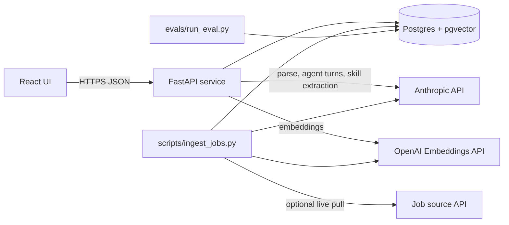

# 03 — Tech Stack & Architecture

**Status:** v1.0 · **Related:** 04 Schema, 05 API, 06 Agent, 07 Evals

---

## 1. Stack decisions

| Layer | Choice | Why |
|---|---|---|
| Language / runtime | Python 3.12 | Matches "Python backends". |
| Web framework | FastAPI + Uvicorn | Async, typed request/response models via Pydantic v2, automatic OpenAPI docs. |
| Database | PostgreSQL with the `pgvector` extension, hosted on Neon or Supabase (free tier) | One store for relational data and vectors; shows SQL + embeddings together. |
| DB access | `psycopg` 3 with a connection pool, plain SQL, plus the `pgvector` Python package | Shows real SQL rather than hiding it behind an ORM. |
| Migrations | Numbered `.sql` files in `migrations/`, applied by `scripts/migrate.py` | Simple and reviewable. |
| LLM | Anthropic API (`anthropic` SDK). Models configured by env vars: `ANTHROPIC_MODEL` (agent) and `ANTHROPIC_PARSE_MODEL` (resume parsing, job skill extraction) | Native tool use. Model IDs are never hard-coded; check the current model list in Anthropic's docs before first run. |
| Embeddings | OpenAI `text-embedding-3-small`, 1536 dimensions | Cheap, fast, widely used. Model and dimension come from `EMBEDDING_MODEL` / `EMBEDDING_DIM`. |
| PDF text | `pypdf` | Pure Python, enough for text-based resumes. Scanned PDFs are unsupported in v1. |
| HTTP client | `httpx` | For job source APIs. |
| Retries | `tenacity` | Backoff on upstream errors. |
| Rate limiting | `slowapi` (in-memory, per IP) | Good enough for one instance; documented limitation. |
| Eval | Plain Python + `pandas` + `numpy` | Custom script shows understanding of the metrics. |
| Tests / lint | `pytest`, `ruff` | Run in CI. |
| Frontend | Vite + React + TypeScript (static build) | Minimal UI; not the focus. |
| Containers | Docker (multi-stage build) | Required skill. |
| Hosting | Railway or Render for the API container; Vercel or Render static for the frontend | Simple deploys. |
| CI | GitHub Actions: `ruff`, `pytest`, Docker build | Shows engineering discipline. |

Dependencies are pinned in `requirements.txt` (generate it from the installed, working environment with `pip freeze` and commit it). Do not guess version numbers in advance.

**Why no agent framework:** the agent loop is about 100 lines (doc 06). Writing it yourself shows you understand tool-calling mechanics.

## 2. System diagram



## 3. Components

| Component | Responsibility | Location |
|---|---|---|
| `api/` | Routes, request/response models, error handling, rate limiting | `app/api/` |
| `services/resume.py` | PDF → text, text → profile (LLM) | `app/services/` |
| `services/embeddings.py` | Embed text, batch, hash-based skip | `app/services/` |
| `services/retrieval.py` | Vector search SQL, pool building | `app/services/` |
| `services/ranking.py` | Score computation (semantic, skill, meta) and final ordering | `app/services/` |
| `agent/` | Agent loop, tool definitions, tool executors, prompts, response schema | `app/agent/` |
| `db/` | Pool, query helpers | `app/db/` |
| `scripts/` | `migrate.py`, `ingest_jobs.py`, `export_snapshot.py` | `scripts/` |
| `evals/` | Dataset, runner, results | `evals/` |

Repository layout:

```
pathfinder/
├── app/
│   ├── main.py
│   ├── config.py            # env parsing (single source of config)
│   ├── api/ (routes_*.py, schemas.py, errors.py)
│   ├── services/ (resume.py, embeddings.py, retrieval.py, ranking.py, skills.py)
│   ├── agent/ (loop.py, tools.py, prompts.py, schemas.py)
│   └── db/ (pool.py, queries.py)
├── migrations/ (001_init.sql, ...)
├── scripts/ (migrate.py, ingest_jobs.py, export_snapshot.py)
├── data/ (jobs_snapshot.jsonl, skill_aliases.json)
├── evals/ (cases/*.jsonl, run_eval.py, results/)
├── frontend/
├── tests/
├── docs/ (these documents)
├── Dockerfile
├── requirements.txt
├── .env.example
└── README.md
```

## 4. Data flows

### 4.1 Ingestion (offline)
1. Read the frozen snapshot (JSONL) or fetch from a live source.
2. Normalize fields; compute `content_hash` of the embedding input text.
3. Upsert on `(source, source_id)`. If `content_hash` is unchanged, skip re-embedding and skill extraction.
4. For new or changed rows: extract `required_skills` (parse model), embed, store.

### 4.2 Resume onboarding
1. `POST /candidates` receives PDF or text; validate type and size.
2. Extract text; cap at 20,000 characters.
3. LLM call with a forced tool schema returns the profile (doc 06).
4. Build the candidate embedding text (summary + skills + titles) and embed it.
5. Store the candidate; return the profile.

### 4.3 Match computation (no LLM call)
1. Load candidate embedding and profile.
2. Retrieve the top 50 active jobs by cosine distance (`<=>`).
3. Compute semantic (min-max normalized within the pool), skill, and meta scores.
4. `final = 0.60 * semantic + 0.25 * skill + 0.15 * meta`; sort descending; return the top N.

### 4.4 Agent turn
1. Load the session and its last 20 messages.
2. Run the loop: call the model, execute tool calls, append results, repeat (max 6 model calls).
3. Validate the final output and job-ID groundedness; persist messages; return the response.

## 5. Configuration (environment variables)

| Variable | Purpose | Example / default |
|---|---|---|
| `ENV` | `local`, `test`, `prod` | `local` |
| `DATABASE_URL` | Postgres connection string | secret |
| `ANTHROPIC_API_KEY` | LLM auth | secret |
| `ANTHROPIC_MODEL` | Agent model | `claude-sonnet-5-5` (verify in docs) |
| `ANTHROPIC_PARSE_MODEL` | Parsing / skill extraction model | `claude-haiku-5-5` (verify in docs) |
| `OPENAI_API_KEY` | Embeddings auth | secret |
| `EMBEDDING_MODEL` | Embedding model | `text-embedding-3-small` |
| `EMBEDDING_DIM` | Vector dimension; must equal the DB column dimension | `1536` |
| `ADZUNA_APP_ID`, `ADZUNA_APP_KEY` | Optional live job source | secret |
| `ALLOWED_ORIGINS` | CORS allow-list (comma separated) | frontend URL |
| `DAILY_LLM_CALL_CAP` | Hard cap on LLM calls per UTC day | `500` |

`.env.example` lists every variable with no real values. `.env` is git-ignored. `config.py` fails fast at startup if a required variable is missing or if `EMBEDDING_DIM` does not match the schema.

## 6. Error handling and resilience

- All upstream calls (LLM, embeddings, job source) use bounded retries with exponential backoff on timeouts, 429 and 5xx.
- Persistent upstream failure → HTTP 502 with a stable error code (doc 05).
- Every request gets a request ID, logged with the route, status and latency. Do not log resume text or full prompts in production.
- A daily LLM call counter (in the database or memory) enforces `DAILY_LLM_CALL_CAP`; when exceeded, return 429 with code `daily_cap_reached`.

## 7. Security and privacy

- Secrets only in environment variables; never committed.
- Candidate IDs are random UUIDs; there is no listing endpoint.
- Upload validation: content type must be `application/pdf` or text; max 5 MB; max 20,000 extracted characters.
- Untrusted text (resumes, job descriptions) is placed inside delimited data blocks in prompts and the model is told to treat it as data, never as instructions (doc 06).
- CORS restricted to `ALLOWED_ORIGINS`.
- Rate limit: 30 requests per minute per IP (agent and candidate-creation routes may use a lower limit).
- `DELETE /candidates/{id}` cascades to sessions, messages and feedback.
- Known limitation: in-memory rate limiting does not coordinate across multiple instances. Run one instance.

## 8. Observability

- Structured JSON logs.
- Log per agent turn: model calls used, tools called, validation outcome (not content).
- `GET /health` checks the database connection.

## 9. Local development

```
cp .env.example .env        # fill in keys
docker compose up -d db     # optional local Postgres with pgvector, or use Neon/Supabase
python scripts/migrate.py
python scripts/ingest_jobs.py --snapshot data/jobs_snapshot.jsonl
uvicorn app.main:app --reload
```

If you use a local Postgres container, use an image that ships the pgvector extension and confirm `CREATE EXTENSION vector` succeeds before continuing.
